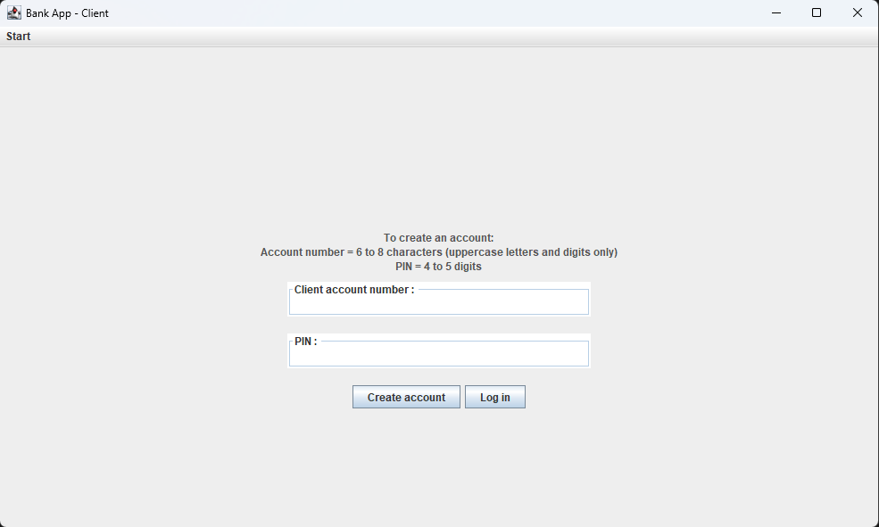
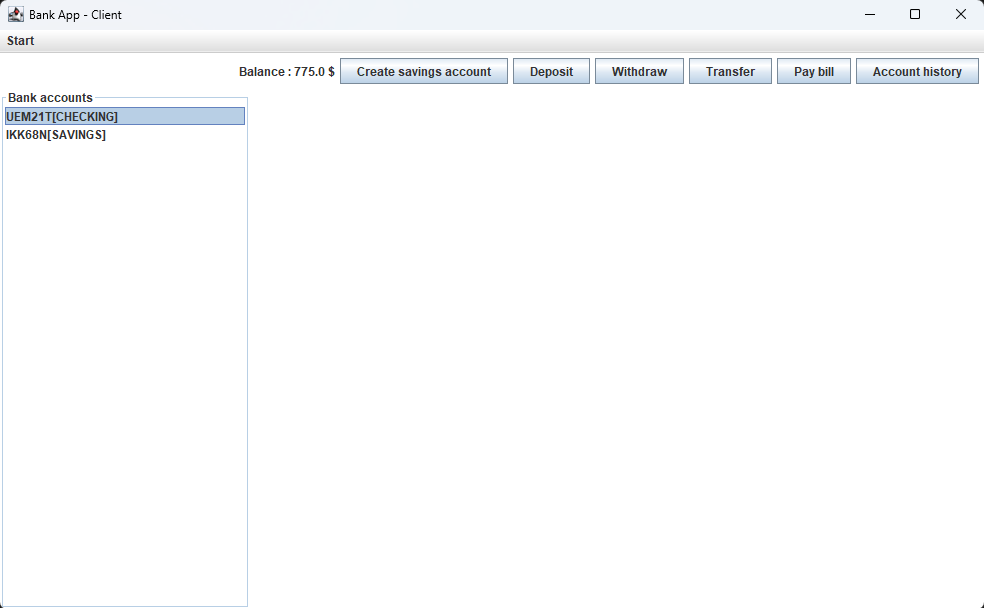
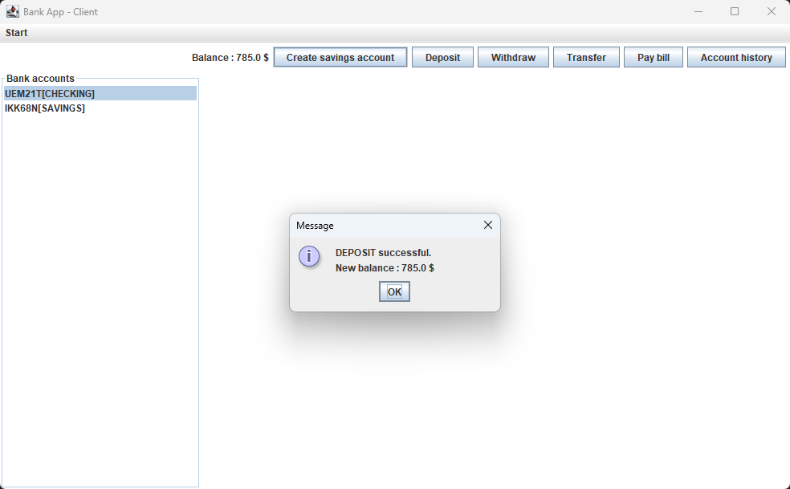
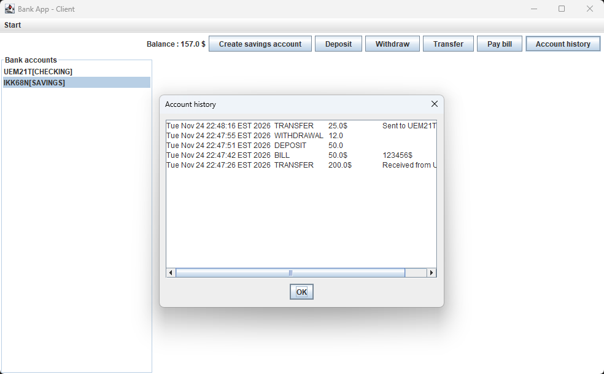

# Client-Server Banking App in Java


A multi-threaded Java client-server banking application with a Swing graphical interface, a custom text protocol over TCP sockets, and file-based persistence.

---

## Screenshots

### Login and account creation
The login screen shows the requirements for creating an account (account number: 6-8 uppercase letters/digits, PIN: 4-5 digits). The input is validated on the client before it is sent to the server.



### Account view
After logging in, the client's checking and savings accounts are listed on the left. Click an account to make it the active one. The current balance and all operation buttons are at the top.



### Banking operations
Deposits, withdrawals, transfers and bill payments prompt for the required values, and the balance updates with the server's response.



### Transaction history
Every operation is recorded in the account history.



---

## Features

* **Client-server architecture:** custom TCP socket communication (`Connection`) with dedicated listener threads for reading incoming text, and automatic disconnection of clients after 30 seconds of inactivity.
* **Swing GUI:** desktop interface (`MainFrame`, `MainPanel`) built with the MVC and Observer patterns.
* **Account management:**
  * Create a client account with a number and PIN (`NEW`), with input validation and a requirements hint in the GUI.
  * Log in with account number and PIN (`CONNECT`).
  * Checking (`CheckingAccount`) and savings (`SavingsAccount`) accounts, selectable from the account list. Savings accounts charge a 2$ fee per operation when the balance is under 1000$.
* **Banking operations (GUI and server protocol):**
  * Deposits (`DEPOSIT`) and withdrawals (`WITHDRAW`)
  * Account-to-account transfers (`TRANSFER`)
  * Bill payments (`BILL`)
  * Transaction history (`HISTORY`), stored in a custom linked stack (`LinkedStack`)
* **Persistence:** the bank is loaded from `bank.data` when the server starts and saved when the server is stopped with `EXIT`.

---

## Protocol

Plain text commands sent by the client; the server replies with the same keyword followed by `OK` or `NO`.

| Command | Example |
|---|---|
| `NEW <number>:<pin>` | `NEW ABC123:1234` |
| `CONNECT <number>:<pin>` | `CONNECT ABC123:1234` |
| `SAVINGS` | create a savings account |
| `SELECT checking\|savings` | choose the active account |
| `DEPOSIT <amount>` / `WITHDRAW <amount>` | `DEPOSIT 100` |
| `TRANSFER <amount> <account>` | `TRANSFER 50 XYZ12A` |
| `BILL <amount> <billNumber> <description>` | `BILL 20 INV42 electricity` |
| `HISTORY`, `LIST`, `EXIT` | |

Rules: client account number = 6-8 uppercase letters/digits; PIN = 4-5 digits.

---

## Project Structure

```text
Bank-Project/
├── BankClient/                  # Client application & Swing GUI
│   └── src/
│       ├── client/              # Socket client, event handlers, entry points (MainFrame, ConsoleClient)
│       │   └── network/         # Connection, events & listener threads
│       ├── controller/          # Swing action & mouse listeners
│       ├── observer/            # Observer/Observable pattern
│       └── view/                # Swing panels & UI components
│
├── BankServer/                  # Server application & banking logic
│   └── src/
│       ├── bank/                # Domain model (Bank, ClientAccount, accounts, operations),
│       │                        # LinkedStack and BankIO (save/load)
│       └── server/              # Server, BankServer, command handler, entry point (ServerMain)
│           └── network/         # Connection, events & listener threads
│
└── screenshots/                 # Images used in this README
```

---

## Running

Requires JDK 17+ (tested on 21).

1. Start the server: In BankServer, run `server.ServerMain` (listens on port 8888).
2. Start the client: In BankClient, run `client.MainFrame`, then **Start → Connect**.
3. Create an account (e.g. number `ABC123`, PIN `1234`) or log in to an existing one.
4. Stop the server by typing `EXIT` in its console so the bank is saved to `bank.data`
   (in the server's working directory).

A console client (`client.ConsoleClient`) is also available for sending raw protocol
commands without the GUI.